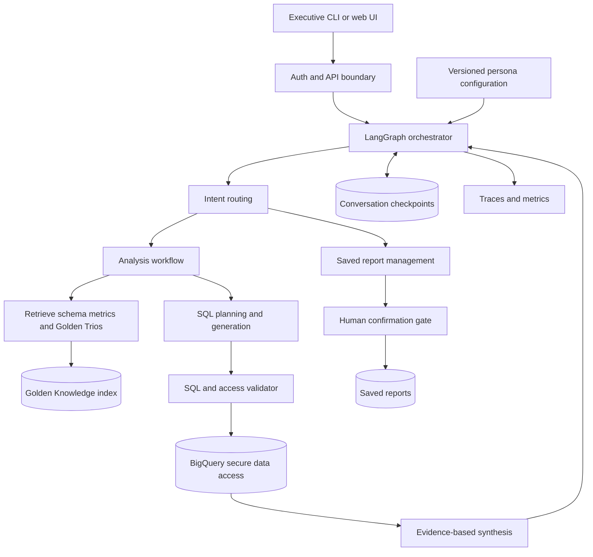
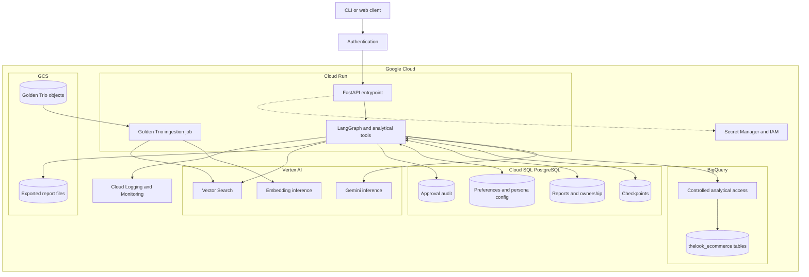

# OpsFleet Retail Analysis Assistant — Architecture

Status: proposed design, not yet implemented. This document is intended to accompany the existing `offsfleet` uv project at `/home/pierre/projects/offsfleet`.

## Existing development baseline

- Python project managed with `uv` in VS Code.
- `.env` exists (do not commit it or include credentials in examples).
- Assignment-provided BigQuery Runner class has been added.
- A basic Gemini chat call has been tested successfully; Gemini 3.8 Flash experienced timeouts under load. Keep the model identifier configurable, and investigate timeouts before committing to a model in production.
- Git repository exists.
- PNG versions of prior architecture diagrams are stored in an image subdirectory. Confirm its exact spelling and paths locally.

These facts are reported by the project owner, not verified against the repository. Inspect the existing code before changing its interfaces or files.

## Design principles

1. One explicit LangGraph workflow, with specialized nodes, before considering multiple autonomous agents.
2. LLMs may propose plans and queries; trusted code enforces authorization, SQL safety, budgets, and destructive operations.
3. Privacy protections act before model inference and again before output or persistence.
4. Analytical answers distinguish measured observations from hypotheses and recommendations.
5. Every external call has bounded latency, retries, and execution budget.
6. Clear separation between mandatory prototype scope and production-only HLD capabilities.

## Logical architecture

## Google Cloud deployment architecture

Cloud Run hosts stateless compute, not durable state. The logical components can initially coexist in one deployment; the ingestion process may be a separate Cloud Run Job. Cloud SQL stores transactional application state, GCS stores source objects and exports, Vertex AI handles models and semantic retrieval, and BigQuery handles analytical queries.

## Analytical flow

1. Validate authenticated identity and product entitlements.
2. Classify request (analysis, schema, report management, unsupported).
3. Resolve conversational references; retrieve relevant schema, metric definitions, and approved Golden Trios.
4. Produce a bounded analysis plan and candidate SQL.
5. Validate SQL AST, tables/columns, entitlement scope, aggregation privacy, and query budget; run BigQuery dry run as appropriate.
6. Execute approved SQL and classify result status.
7. Repair correctable SQL errors with bounded attempts; never loosen authorization merely to get a result.
8. Synthesize insights with evidence, caveats, and recommendations; validate output for privacy and grounding.
9. Emit structured telemetry and preserve minimally necessary conversation state.

## Security boundary

The public dataset has no native executive-to-product entitlement mapping. Implement an application-owned mapping and a trusted execution layer that makes unauthorized access impossible. Merely inserting a user-provided product filter into a prompt is insufficient. A single backend service account does not automatically acquire per-user BigQuery row-level isolation. Exclude raw customer PII before sending data to models, suppress small cohorts, and reject privacy-invasive queries.

## Report deletion flow

Resolve exact report IDs owned by the authenticated user; display names/count; persist pending operation; pause with LangGraph interrupt; on explicit confirmation, revalidate user and frozen target set; perform idempotent soft deletion; audit. Cancellation has no side effect. Handle report files in GCS consistently.

## Production-only extensions

- Golden Trio ingestion/approval/versioning and semantic retrieval.
- Offline evaluation and human-reviewed learning loop.
- Cross-session user preferences and nondeveloper persona administration.
- Optional chart generation, email dispatch with explicit authorization, web research, scheduled reporting.
- Comprehensive IAM, networking, retention, secret management, monitoring, and disaster recovery.

## Open decisions

- Confirm what defines revenue, returns, churn, and reporting periods.
- Define executive/product entitlement granularity.
- Decide what synthetic Golden Trios are acceptable for demonstration.
- Decide report soft-delete retention and export deletion semantics.
- Determine supported Gemini model and sensible timeout/retry budgets from actual account quotas.

