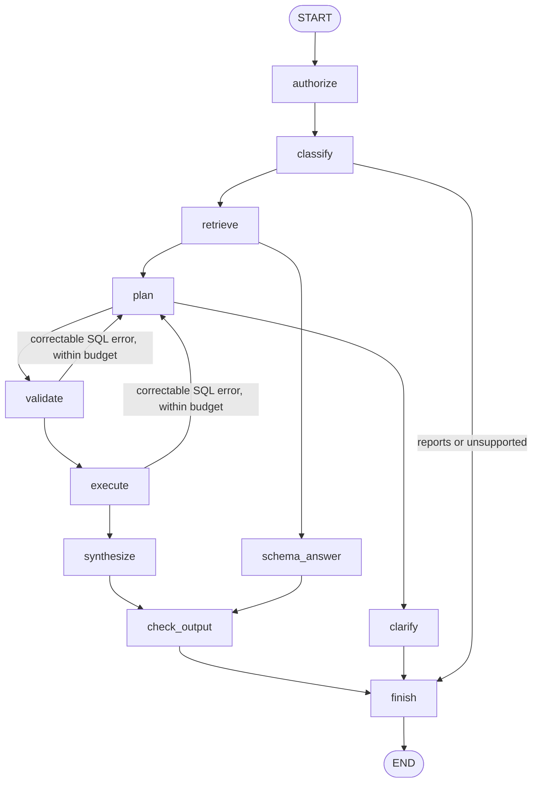

# AI Technical Assignment - Retail Company

CLI retail analysis assistant in development. See [ARCHITECTURE.md](ARCHITECTURE.md)
and [REQUIREMENTS.md](REQUIREMENTS.md) for the proposed system and full scope.
The original assignment has now been reviewed; see
[ASSIGNMENT_REVIEW.md](ASSIGNMENT_REVIEW.md) for the mandatory/design-only split and
remaining submission gaps.

The initial LangGraph workflow is implemented in `src/graph.py`. The restricted
aggregate executor is implemented in `src/trusted_bq.py`; see
[trusted executor integration](TRUSTED_EXECUTOR.md) for its supported SQL and wiring.
`main.py` supports single aggregate questions and an interactive conversation with
strict request and output checks. The three executive scopes are configured locally.
Typed follow-up context and a bounded aggregate cache live in memory for one identity.
Owned reports and deletion approvals persist in PostgreSQL (`datachatdb`) with
per-executive row-level security; see [REPORTS.md](REPORTS.md) and
[docs/postgresql.md](docs/postgresql.md).
Production authentication, durable analytical conversations and broader language
support remain to be added.
Request tracing and shared execution budgets are implemented; see
[OBSERVABILITY.md](OBSERVABILITY.md) for controls, metrics and an offline debugging demo.

## Local analysis and conversation

`config/grants.local.json` is administrator-managed and ignored by Git. It now
contains these version-2 catalog grants (also recorded in
`config/grants.executives.json` for reproducibility):

| Executive | CLI identity | Catalog scope |
| --- | --- | --- |
| User A | `user-a` | Men department, excluding Accessories |
| User B | `user-b` | Women department, excluding Accessories |
| User C | `user-c` | Accessories category, both departments |

The source dataset contains Accessories in both departments. Clothing grants
exclude it to keep the three scopes disjoint. Catalog rules apply in trusted SQL
on every execution, so new matching products are covered without a stale ID list.
Department and category include rules are ANDed, followed by category exclusions.
Exclusions alone cannot grant access. Version-1 explicit product-ID lists remain
supported; `config/grants.example.json` shows that format with a fictional user.
Unknown users and missing/malformed configuration are denied before external calls.
Edits are reloaded on every lookup, including execution-time revalidation.

Run any configured identity:

```bash
uv run python main.py --user user-a --model gemini-3.6-flash
uv run python main.py --user user-b --model gemini-3.6-flash
uv run python main.py --user user-c --model gemini-3.6-flash
uv run python main.py --user user-a --model gemini-3.6-flash --chat
uv run python main.py --user user-b --model gemini-3.6-flash --question "Show total item sale value by status"
```

On another checkout, pass `--grants config/grants.executives.json` explicitly or
copy that reviewed configuration to `config/grants.local.json` first. The CLI never
silently falls back to example grants if the local configuration is missing.

Without `--chat` or `--question`, the CLI asks “How many order items can I access?”
In chat mode, try this sequence:

```text
Show item counts by category
completed items only
by month
from 2026-01-01 to 2027-01-01
total item sale value instead
/reset
Show average item sale price by status
/quit
```

Use `/help` for the full approved phrase list. Counts, total item sale value and
average item sale price support grouping by category, UTC item month or item status.
Follow-ups retain the previous successful metric/grouping/filters; a new full
question starts fresh. Date filters use explicit month boundaries with an exclusive
end. Unsupported text triggers clarification before model inference, and failed
turns do not replace the last successful request. `/reset`, a new process or a
change in product grants clears context. Sessions cannot switch users through chat.

`src/conversation.py` resolves phrases to an immutable request, then supplies
canonical, PII-free input to the graph. Gemini proposes SQL and returns structured
aggregate rows. Trusted code requires the generated SQL to match the resolved
request and every returned value to match BigQuery evidence. Final output is an
escaped table with deterministic caveats; unsupported claims or rounded values
are rejected. Every turn is reauthorized, and grant changes during inference block
publication. No raw transcript is retained. Up to eight successful aggregate results
are cached in memory for report generation (128,000-byte total budget). Only an
explicit `/report` or `--report` action saves a report and its aggregate evidence.
Each analytical request executes one query, with the existing per-query cost/row limits.

Small-cohort suppression applies separately to each group. Omitted/empty groups
are not zero, and displayed group totals may exclude suppressed groups. Item sale
value is not approved net revenue; status/returns/currency definitions still need
review. Free-form analysis, causal explanations, autonomous multi-query planning and durable
checkpointed conversations remain future work. `build_count_graph` remains as the
original count-only API; the CLI now uses `AnalysisSession` and `build_analysis_graph`.

`--user` selects a local operator test identity. It is **not authentication** for a
multi-user application. Anyone who controls this CLI or the grant file is a trusted
administrator; do not expose identity selection or grant-file paths through a web
request. A deployed service must get the identity from verified authentication and
keep grant configuration accessible only to administrators.

```bash
cp .env.example .env                        # then fill in keys and PG_* superuser credentials
uv sync
uv run python -m scripts.setup_datachatdb   # once: PostgreSQL roles, datachatdb(+_test), schema
uv run python -m unittest discover -s tests -v
```

`scripts/setup_datachatdb.py` uses the installation superuser in `PG_*` only to create
roles and databases, then writes dedicated `DATACHAT_DB_*` credentials to `.env`; the
application and tests use only those. Report tests run against the disposable
`datachatdb_test` database and are skipped if it is unreachable. See
[docs/postgresql.md](docs/postgresql.md).

The tests use synthetic fixtures and make no Google API calls. Real use needs an
API key and a supported model ID for Gemini, plus Application Default Credentials
and a billing project for BigQuery. Those are separate authentication mechanisms.
Keep credentials in local configuration; do not commit them.

Create and manage reports in chat:

```text
/report
/reports
/show REPORT_ID
/delete conversation
/cancel OPERATION_ID
/delete conversation
DELETE OPERATION_ID
/audit
```

The preview shows exact report IDs/titles before a LangGraph approval interrupt.
Only the matching `DELETE OPERATION_ID` confirms deletion; cancellation leaves
reports intact. The library is the PostgreSQL database `datachatdb`; provision it once
with `uv run python -m scripts.setup_datachatdb`. Read [REPORTS.md](REPORTS.md)
for search-based deletion, ownership/scope rules, restart recovery and the offline
demo `uv run python -m examples.report_demo`.

There are 63 offline tests covering request grammar, multi-turn context, user/grant
isolation, SQL drift, exact output grounding, CLI commands and the executor. The
grouped category-count question passed live for User A. A live completed-items
follow-up reached BigQuery but failed during Gemini synthesis with HTTP 429; a
subsequent follow-up/average-price retry remained blocked at inference. Those
paths pass offline tests but are not yet fully verified live. Rate/quota errors
now produce an explicit safe CLI message and preserve the prior successful request.
The latest live retry still returned HTTP 429. A minimal diagnostic confirmed a
daily free-tier request quota with a reported limit of 20 for Gemini 3.6 Flash;
this was not identified as a per-minute limit. Follow-up and average-price live
verification remain pending until quota is available.

An optional local Golden Trio demo adds eight further offline tests (71 total).
Start chat with `--golden-demo` to include clearly labeled synthetic question/SQL/
report-template references. The corpus contains no synthetic database rows and no
live analytical observations. References are audience-filtered, versioned and SQL
validated before entering model context; they never replace live evidence or the
approved request SQL. This first retrieval implementation uses metric/grouping
matching rather than embeddings, makes no additional retrieval API calls and
does not claim the templates are human-reviewed historical analyst reports.
Report generation/storage/approval coverage brings the complete suite to 101 tests.
Shared request budgets and privacy-safe trace coverage bring the current total to
125 tests. CLI traces default to `.local/traces.jsonl`; failed turns print their
request ID. Inspect aggregate outcomes with:

```bash
uv run python -m src.trace_summary .local/traces.jsonl
uv run python -m examples.trace_demo
```

Request deadlines, physical model attempts, query submissions/dry runs and aggregate
query byte caps are shared across retries/repairs. Daily quota errors stop retrying;
transient retries use provider hints within the remaining budget. Token usage is
recorded when returned by Gemini, with missing metadata explicitly distinguished.
No prompts, SQL text, data rows, report bodies or API keys are written to traces.

## Current integration



Failures also route to `finish`; exhausted query repairs produce a controlled error.
The intent classifier is a convenience router. Authorization and privacy checks
are trusted services and must remain effective even if classification is wrong.
Report commands are routed locally before this analytical graph; destructive report
operations use the separate approval graph documented in `REPORTS.md`.

| Existing component | Integration |
| --- | --- |
| `query_gemini(prompt, model=...)` | Called by classification, planning, schema answering and synthesis. The graph supplies the model explicitly, uses a 30-second per-attempt timeout and two adapter retries. No second generic retry wrapper is added. |
| `BigQueryRunner.get_table_schema()` | Source for approved schema context. Fetch/cache allowlisted schema, omit descriptions or fields that should not reach the model, and add reviewed metric definitions. |
| `BigQueryRunner.client` | Used by `TrustedBigQueryExecutor` for scoped dry runs and bounded aggregate queries. The original `execute_query()` remains available for developer use; it must not be exposed to generated SQL. |
| DataFrame result | Keep local to the executor. Return only bounded, privacy-checked aggregate evidence as JSON; never pass arbitrary rows to Gemini or store a DataFrame in graph state. |

The runner's missing `Any` import has been fixed and its missing BigQuery/DataFrame
dependencies declared. Its interfaces otherwise remain unchanged. Required executor
columns and types were verified against BigQuery, and a scoped live count succeeded;
see `TRUSTED_EXECUTOR.md`. Broader schema/join/metric verification remains outstanding.
The architecture documents refer to `offsfleet`; the actual repository is `opsfleet`
and its image directory is `images/`.

## Using the graph

Construct `AnalysisServices` from application-owned callables, then:

```python
from src.graph import build_graph

# services: an AnalysisServices instance implementing the trusted contracts below.
graph = build_graph(services, model=configured_model_id, max_repairs=1)
result = graph.invoke({"question": "How many completed orders?",
                       "user_id": authenticated_user_id})
print(result["answer"])

# For debugging with synthetic data:
# print(graph.get_graph().draw_mermaid())
```

This is generic wiring guidance. The supported application provides services through
`build_analysis_graph()`; use the CLI for a live example. For an offline fixture,
read `tests/test_graph.py`. Nodes return partial
state updates, ordinary edges advance a stage, and conditional edges choose the
next stage. State records the safe question, context, plan, SQL, aggregate evidence,
repair count and answer. Model calls and service objects live outside that state.

The initial graph compiles without a checkpointer. Invoke it once per request;
it does not retain history. Do not enable persistence of this state as-is:
authorization executes after the input enters the graph, so raw request text could
otherwise be checkpointed before sanitization. Sanitize at the API/CLI boundary
before adding checkpoint persistence, and expose only the final answer to users.

## Implementation sequence

1. **Approve schema, metrics and entitlement fixtures.** Inspect the four tables
   with authenticated read-only access. Record joins, timestamp semantics and order
   statuses. Decide whether revenue means completed item sale price, how returns
   are excluded, and the reporting timezone. Create two synthetic identities with
   disjoint product grants. Do not infer identity or grants from a chat message.

2. **Implement `AnalysisServices`.** `authorize_request(question, user_id)` looks
   up authenticated grants and rejects or sanitizes unsafe input before any model
   call. `retrieve_context(question, user_id)` returns approved schema, metrics,
   and eventually access-filtered Golden Trios and sanitized conversation history.
   `validate_sql(sql, user_id)` parses BigQuery SQL, validates a single allowed read
   query, resolves all tables/columns/subqueries, rejects PII and external access,
   and returns canonical SQL. A regex or prompt-based filter is insufficient.

3. **Build the trusted executor.** `execute_sql(sql, user_id)` rechecks current
   grants and SQL at the data-access boundary. Use controlled views or an audited
   AST transformation so every relevant source is restricted to allowed products;
   joins, CTEs and subqueries must not bypass scope. Dry-run the same scoped SQL,
   apply `maximum_bytes_billed`, disable legacy SQL, cap rows, set job/API timeouts,
   and cancel jobs that exceed their deadline. Enforce minimum cohort size and
   allowed output columns before returning aggregate JSON. Extend the runner with
   explicit job configuration and metadata; its current one-argument method cannot
   enforce this contract. Test bypass attempts before enabling real execution.

4. **Complete the minimal live slice.** `validate_output(answer, evidence, user_id)`
   enforces privacy and grounding before publication. Only a sanitized SQL syntax
   or schema error should raise `RepairableQueryError`; permission, privacy, budget
   and authorization failures raise `PolicyDenied`. Outages become controlled
   failures, not SQL-repair prompts. Run one reviewed count question end to end,
   then empty-result, denied-product and denied-PII cases. The graph's single repair
   default means at most two candidate SQL attempts. The trusted executor's scoped
   count and complete Gemini-to-BigQuery count paths have passed for all three users.
   Approved grouped analysis now also uses exact SQL/output checks.

5. **CLI and safe conversation context (initial implementation complete).**
   `main.py --chat` invokes the graph and prints only the final answer. The local
   operator selects an identity from trusted grants; production authentication is
   still needed. `AnalysisSession` retains only one successful typed request for
   follow-ups, clears it on grant changes/reset, and rebuilds query/evidence/error
   state on every turn. Next add authenticated session IDs and durable checkpoints,
   with authorization on each thread and sanitization before persistence.

6. **Support multi-step analyses.** Replace the single `plan/sql/evidence` slots
   with a bounded list of query steps and evidence keyed by step ID. Every step
   repeats validation and trusted execution. The shared request deadline and
   model/query/byte ledger are now implemented; reuse the same request scope across
   future plan steps. Deadlines are cooperative and services must bound their own
   blocking calls. Avoid treating lack of results as permission to widen access.

7. **Saved reports and deletion (local implementation complete).** Deterministic
   reports combine recent validated analyses with findings and action items. PostgreSQL
   row-level security enforces owned storage and durable pending operations. The separate LangGraph
   workflow freezes IDs/versions, interrupts for explicit token-bound confirmation,
   revalidates ownership/expiry/versions and soft-deletes atomically with audit.
   Cancellation has no report side effect. Production authentication, retention,
   export lifecycle and managed durable storage remain deployment work.

8. **Resilience and observability (local implementation complete).** Shared request
   IDs correlate node/model/query/report events. JSONL traces include latency,
   retries, usage metadata, query/job bytes and structured failures without raw
   content. Cooperative deadlines and shared call/query/byte budgets prevent further
   external work after exhaustion. An offline failure-injection demo and summary
   command support debugging. Production monitoring, retention and distributed
   budgets remain deployment work.
   
9. **Implement production extensions separately.** Durable storage, Cloud Run/IAM,
   Vertex AI authentication, Golden Trio ingestion/retrieval, preferences, persona
   management and feedback evaluation follow the design documents. The present
   Gemini adapter calls the Developer API with an API key; moving to Vertex AI
   requires a different inference/auth adapter, not just a different model name.

The supported subset of milestones 2–5 is implemented: trusted execution, approved
aggregate requests, exact grounding, three local grant scopes and in-memory follow-ups.
Broader language/schema support, production authentication, durable state, multi-query
analysis remain separate work. Local multi-section
reports and owned saved-report approval/deletion are now implemented.

LangGraph references: [Graph API](https://docs.langchain.com/oss/python/langgraph/graph-api)
and [interrupts](https://docs.langchain.com/oss/python/langgraph/interrupts).
