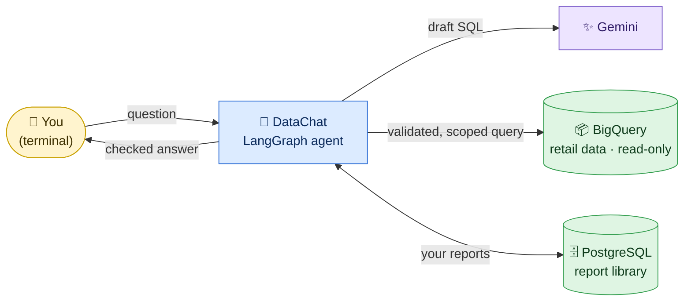

<div align="center">

# 📊 DataChat — OpsFleet Retail Analysis Assistant

**Ask questions about retail sales in plain English, get answers you can trust, and keep your findings as reports.**


[](https://hub.docker.com/r/delaray/datachat)

[Install](docs/user-guide/01-installation.md) ·
[Use](docs/user-guide/02-using-datachat.md) ·
[Roles & Security](docs/user-guide/03-roles-and-security.md) ·
[Examples](docs/user-guide/04-examples.md) ·
[Troubleshooting](docs/user-guide/05-troubleshooting.md)

</div>

---

## 🧭 What is DataChat?

DataChat is a **terminal chat assistant for retail executives**. You type a question such as
*"Show item counts by category"*, and DataChat:

1. checks that you are allowed to see the data you asked about,
2. asks Google **Gemini** to draft a query, then checks that query against strict rules,
3. runs it against the retail dataset in Google **BigQuery** (read-only),
4. shows the answer as a table, with notes on how to read it.

You can refine the question in follow-up turns ("*completed items only*", "*by month*"), turn your
analyses into a **saved report** with findings and action items, and later **delete** reports you
own. Every deletion needs your explicit confirmation.



*How to read this diagram:* your question goes only to DataChat. DataChat uses Gemini to draft the
query, but **trusted code** checks that draft and adds your product restrictions before BigQuery runs
it. Reports are stored in PostgreSQL, and each executive can see only their own.

## ✅ What you can do

| | Task | You type… | Details |
|:-:|---|---|---|
| 🔍 | **Analyze data** over several turns | `Show item counts by category` → `completed items only` → `by month` | [Using DataChat § 1](docs/user-guide/02-using-datachat.md#task-1--analyze-data) |
| 📝 | **Create and read reports** | `/report` · `/reports` · `/show REPORT_ID` | [Using DataChat § 2](docs/user-guide/02-using-datachat.md#task-2--create-and-read-reports) |
| 🗑️ | **Delete your reports** (with confirmation) | `/delete conversation` → `DELETE OPERATION_ID` | [Using DataChat § 3](docs/user-guide/02-using-datachat.md#task-3--delete-reports) |

> [!IMPORTANT]
> DataChat understands a **fixed set of approved questions and follow-ups**, not free-form
> English. This is deliberate: every accepted phrase maps to a query that can be checked exactly.
> Type `/help` at any time to see the full list.

## 👥 Who you can be

There are three executive identities. Each one sees a **different, non-overlapping** part of the
product catalog:

| Identity | Executive | Products visible | Hidden from this identity |
|---|---|---|---|
| 🟦 `user-a` | User A | **Men's** department | Accessories, all Women's products |
| 🟪 `user-b` | User B | **Women's** department | Accessories, all Men's products |
| 🟩 `user-c` | User C | **Accessories** (both departments) | All other categories |

You choose the identity when you start DataChat (`--user user-b`). You can't switch identity in
the middle of a chat. See [Roles & Security](docs/user-guide/03-roles-and-security.md) for details.

## 🚀 Quick start (Docker)

You need **Git**, **Docker** (with Compose), the **gcloud CLI**, **uv**, a **Gemini API key** and a
**Google Cloud project** with BigQuery enabled. The [installation guide](docs/user-guide/01-installation.md)
explains how to get each one.

```bash
# 1. Get the project
git clone https://github.com/delaray/opsfleet.git datachat && cd datachat

# 2. Configure: add your Gemini key, GCP project and a database password
cp .env.example .env && nano .env

# 3. Let BigQuery use your Google account
gcloud auth application-default login

# 4. Package your credentials as Docker secrets (stored in ./secrets, never in the image)
uv run --no-project --with python-dotenv python -m scripts.make_docker_secrets

# 5. Download the public image, start the report database, then chat
docker compose pull        # pulls delaray/datachat:1.0.0 from Docker Hub
docker compose up -d postgres
docker compose run --rm datachat --chat --user user-a
```

When the `You>` prompt appears, try:

```text
You> Show item counts by category
You> completed items only
You> /report
You> /quit
```

> [!TIP]
> Prefer running without Docker? The [installation guide](docs/user-guide/01-installation.md#option-b--local-python-installation)
> also covers a local Python install with **uv** and **PostgreSQL**.

## 📚 Documentation

| Guide | Read it when you want to… |
|---|---|
| 🛠️ [**1. Installation**](docs/user-guide/01-installation.md) | Install DataChat with Docker or Python, and check that it works |
| 💬 [**2. Using DataChat**](docs/user-guide/02-using-datachat.md) | Learn the questions, follow-ups and report commands, with a one-page cheat sheet |
| 🔐 [**3. Roles & Security**](docs/user-guide/03-roles-and-security.md) | Understand identities, authentication, validation, privacy and audit |
| 🎬 [**4. Examples**](docs/user-guide/04-examples.md) | Follow complete sessions, from first question to deleted report |
| 🩺 [**5. Troubleshooting & FAQ**](docs/user-guide/05-troubleshooting.md) | Understand an error message, limits, quotas and tips |

<details>
<summary><b>For developers and reviewers</b></summary>

| Document | Topic |
|---|---|
| [docs/README.dev.md](docs/README.dev.md) | Developer README: implementation status, graph wiring, tests |
| [ARCHITECTURE.md](ARCHITECTURE.md) | Production high-level design |
| [TRUSTED_EXECUTOR.md](TRUSTED_EXECUTOR.md) | The restricted BigQuery executor |
| [REPORTS.md](REPORTS.md) | Report generation, ownership and the deletion workflow |
| [OBSERVABILITY.md](OBSERVABILITY.md) | Tracing, budgets and debugging |
| [docs/postgresql.md](docs/postgresql.md) · [docs/docker-image.md](docs/docker-image.md) | Database and container details |

</details>

---

<div align="center">
<sub>DataChat is a proof of concept. The <code>--user</code> option selects a test identity on your own machine; it is not a login system.
See <a href="docs/user-guide/03-roles-and-security.md">Roles &amp; Security</a>.</sub>
</div>
