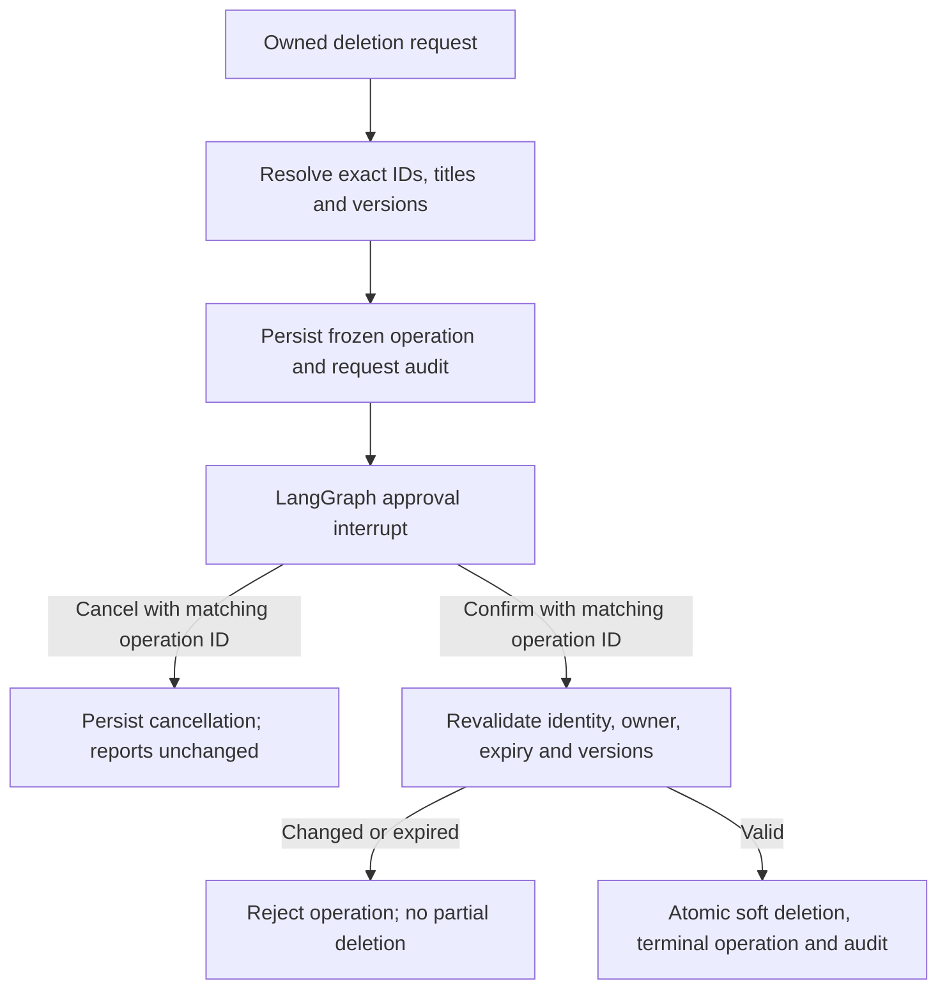

# Reports and confirmation-based deletion

The local POC now generates grounded reports, stores them persistently with an owner,
and deletes only an explicitly confirmed, frozen set of owned reports. No model call
is needed to generate a report from existing validated analyses or to manage the library.

## Usage

```bash
uv run python main.py --user user-a --model gemini-3.6-flash --chat
```

```text
Show item counts by category
completed items only
create a report with action items
/reports
/show REPORT_ID
/delete conversation
/cancel OPERATION_ID
/delete mentioning Order items
DELETE OPERATION_ID
/audit
```

Replace IDs with the exact IDs printed by the application. A plain `yes` does not
confirm deletion. The command `Delete all the reports we made in this conversation`
selects the current conversation's owned reports. `Delete all reports mentioning
Client X` performs a literal, case-insensitive search of currently viewable owned
reports. Client names are not part of our retail schema, so that example only
matches if the text actually exists in a generated report; it does not invent clients.
SQL wildcard characters in the search text are not expanded.

`/report` generates **and saves** the report. A one-shot alternative is:

```bash
uv run python main.py --user user-a --model gemini-3.6-flash \
  --question "Show item counts by category" --report
```

The chat startup prints a conversation UUID. Pending approvals and saved reports
survive restart. To recover a pending operation in its original conversation:

```bash
uv run python main.py --user user-a --model gemini-3.6-flash \
  --chat --conversation-id ORIGINAL_CONVERSATION_UUID
```

Use `/pending` or `/resume OPERATION_ID`, inspect the exact target list again, then
submit `DELETE OPERATION_ID` or `/cancel OPERATION_ID`. Resuming does not rerun a
search, add newly matching reports, or extend the original 15-minute expiry.
Restarting does not restore unsaved analysis context; run another analysis before
creating a new report. `/reset` clears in-memory evidence and follow-up context,
but does not delete saved reports or cancel pending operations.

## Report generation and grounding

`AnalysisSession` retains up to eight recent successful analyses, within 128,000
bytes of aggregate evidence. A repeat of the same request replaces its earlier
result. Failed turns are not retained. Reset or a change in grants clears this cache.
No raw conversation transcript, raw customer rows, model draft prose or API keys
are saved in a report.

`src/report_generation.py` builds a deterministic multi-section report with:

- The exact published aggregate values and selected status/date filters.
- Measured findings, including explicit ties for highest visible group values.
- Action items framed as investigation steps, tied to the available metric.
- Privacy, partial-period, currency, return/status and causal-interpretation caveats.
- Source request specifications, canonical logical SQL and aggregate evidence.

Reports do not invent causes or claim suppressed groups are zero. They do not
average grouped averages or claim financial meaning for an undefined revenue metric.
This combines already-completed analyses; it is not yet an autonomous multi-query
quarterly-report planner. The generated content is structured by trusted code,
rather than accepting unrestricted model-written claims while Gemini is rate limited.

## Ownership, grants and persistence

The default database is `.local/opsfleet.sqlite3`, ignored by Git. Select another
administrator-controlled local file with `--reports-db`. New files are created with
owner-only permissions, and all database values use SQL parameters.

`src/report_store.py` stores conversations, reports, pending deletion operations and
audit events. Reports include owner, conversation, creation timestamp, version,
body, aggregate sources and a hash binding them to the original product grants.
The store does not persist the full product grant list. Only the owner can retrieve
a report; its body also requires the same current scope fingerprint. A scope change
blocks old report content until that scope is restored. The owner may still delete
their old reports using IDs, conversation selection or all-owned selection. Search
over report content is restricted to currently viewable reports to avoid an oracle
over revoked data. Lists expose only generated titles and IDs, not report results.

The application rechecks identity/grants before generation, save, retrieval and
approval execution. The local CLI operator is still trusted to select `--user`;
this is not a replacement for production authentication or per-request API identity.
SQLite files and audit rows are trusted local application storage, not a tamper-proof
audit system against a machine administrator. Application-level checks cannot provide
instantaneous revocation without coordinating the grant store and in-flight requests.

## Deletion workflow



`src/report_workflow.py` uses a real LangGraph `interrupt()` and `Command(resume=...)`.
Its in-memory checkpoint holds only an operation ID and decision/status; the interrupt
payload contains safe generated titles, IDs and versions, not report bodies. The
SQLite operation is the durable source of truth. A fresh graph can reconstruct the
same approval interrupt after restart without resolving targets again. This avoids
requiring durable checkpoints for raw analytical state in the initial POC.

An operation contains at most 100 reports. Broader matches fail safely and ask for a
narrower selection; they are never silently truncated. On confirmation, `BEGIN
IMMEDIATE` serializes the version checks, all soft deletions, terminal operation
status and audit event in one transaction. If any target has changed, disappeared
or already been deleted, the entire operation becomes stale without deleting the
remaining targets. A report created after the preview is never included. An audit
write failure rolls the transaction back. Replaying an already resolved operation
returns its existing outcome without another deletion or duplicate completion audit.

Cancellation changes only the operation/audit state, not reports. Confirmations
expire 15 minutes after preparation; expired operations are rejected when resumed.
The library hides soft-deleted reports from list/get/search. Their body and sources
remain in the database for now: physical erasure, retention policies and backup
purging are separate production work. No GCS export files exist in this POC.

## Offline verification

```bash
uv run python -m unittest discover -s tests -v
uv run python -m examples.report_demo
```

The demo uses clearly marked synthetic aggregates and a temporary database, with
no Google calls. It demonstrates report creation, preview, cancellation, a new
preview, explicit token confirmation and audit. It never operates on the real
report library. The full suite now contains 125 tests, including ownership, scope
changes, bounded report history, exact search, frozen targets, stale versions,
competing database connections, rollback on audit failure, expiry, restart recovery,
actual LangGraph interrupt/resume and CLI routing. No new live model test was needed.

LangGraph reference: [interrupt and resume](https://reference.langchain.com/python/langgraph/types/interrupt).
