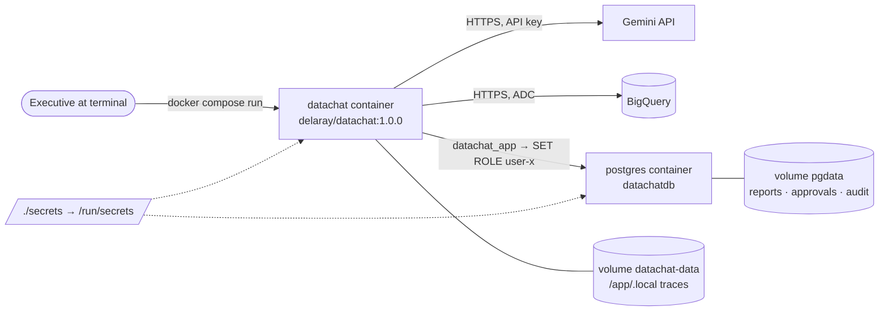

# Docker image and Compose deployment

The interactive OpsFleet chat runs in one application container,
**`delaray/datachat:1.0.0`**, which talks live to Gemini and BigQuery. Docker Compose
adds the official `postgres:18` container that holds the `datachatdb` report library
(see [postgresql.md](postgresql.md)).



## Files

| File | Purpose |
|------|---------|
| `Dockerfile` | Multi-stage build of the app image. |
| `.dockerignore` | **Allow-list** build context: only `main.py`, `src/`, `config/grants.executives.json`, `config/grants.example.json`, `knowledge/`, `db/`, `docker/entrypoint.py`, `pyproject.toml`, `uv.lock`. `.env`, `secrets/`, `.local/`, docs, tests and diagrams can never enter the image. |
| `docker/entrypoint.py` | Loads `*_FILE` secrets into environment variables, then runs `main.py` with the container arguments. |
| `compose.yaml` | `postgres` and `datachat` services, secrets and volumes. |
| `docker/initdb/01-datachat.sql` | First-start database initialization: roles, database privileges, then `db/schema.sql`. |
| `scripts/make_docker_secrets.py` | Creates `./secrets/` from `.env` and your gcloud Application Default Credentials. |
| `.gitattributes` | Forces LF line endings on files executed inside Linux containers. |

## Dockerfile

- **Stage `build`** (`python:3.13-slim` + `uv` 0.8.22): `uv sync --frozen --no-dev
  --no-install-project` installs exactly the locked runtime dependencies from
  `uv.lock` into `/opt/venv`. Dev tools (`ipython`, `pre-commit`) are excluded.
- **Final stage** (`python:3.13-slim`): copies `/opt/venv` and the application files
  only, so the build tooling isn't in the final image.
  - Runs as the unprivileged user `datachat` (uid 10001).
  - `DATACHAT_GRANTS_FILE=/app/config/grants.executives.json` makes the executives'
    grants the default `--grants` (`main.py` reads this variable).
  - `/app/.local` (traces) is a declared volume owned by `datachat`.
  - `ENTRYPOINT` is the secret-loading entrypoint. `CMD ["--help"]` shows the CLI options
    when the image is run with no arguments.
- Image size is about 815 MB, mostly google-cloud-bigquery, pandas and the Python runtime.

## Secrets: how they are provided

No secret is passed as a build argument, written to an image layer, or set as a plain
environment variable in `compose.yaml`. I checked: the built image's layers were scanned
for the Gemini key, the DB password and the OAuth refresh token, and none were found.

Secrets are **Compose secrets**: files in `./secrets/` (ignored by Git and the build
context) that Compose mounts read-only at `/run/secrets/<name>` when a container starts.

| Secret file | Mounted in | Consumed as |
|-------------|-----------|-------------|
| `gemini_api_key` | datachat | `GEMINI_API_KEY_FILE` → `GEMINI_API_KEY` (by the entrypoint) |
| `datachat_db_password` | datachat, postgres | App login password (`DATACHAT_DB_PASSWORD_FILE`), and the password the init script sets for `datachat_app` |
| `admindb_password` | postgres | `POSTGRES_PASSWORD_FILE` for `admindb` |
| `gcp_adc.json` | datachat | `GOOGLE_APPLICATION_CREDENTIALS=/run/secrets/gcp_adc` (BigQuery auth) |

`secrets/app.env` holds the **non-secret** settings (`PROJECT_ID`, `PROJECT_NAME`,
`DATASET_ID`, `GEMINI_MODEL_1`, `GEMINI_MODEL_2`) and is loaded with `env_file`.

The entrypoint must set `GEMINI_API_KEY` before `main.py` is imported, because
`src/gemini.py` reads it at import time. It removes the `*_FILE` variables once used.

`gcp_adc.json` is a copy of your `gcloud auth application-default login` user
credentials. For a shared or server deployment, use a dedicated service-account key
or workload identity instead, with BigQuery Job User + Data Viewer roles only.

## compose.yaml

### `postgres`
- Image `postgres:18`, `POSTGRES_USER=admindb`, `POSTGRES_DB=datachatdb`, password from
  the `admindb_password` secret. Inside this container `admindb` is the cluster
  superuser. That's normal for the official image, but stricter than on the host.
- On the **first start only** (empty `pgdata` volume), `docker/initdb/01-datachat.sql`
  creates `datachat_app`, `datachat_executive` and `user-a/b/c`, restricts `CONNECT`, and
  includes `db/schema.sql` (tables, grants, forced row-level security). That is the same
  security model as the host installation.
- No port is published, so it doesn't conflict with your host PostgreSQL on 5432. Only
  containers on the Compose network can reach it.
- A `pg_isready` healthcheck gates the app (`depends_on: condition: service_healthy`).

### `datachat`
- `image: delaray/datachat:1.0.0` with `build: .`: `docker compose build` builds and
  tags it locally, and on another machine `docker compose pull` fetches it from Docker Hub.
- Connects as `datachat_app` to host `postgres`. Every report transaction switches to the
  executive's role, so row-level security applies exactly as on the host.
- `stdin_open` + `tty` support the interactive chat. The default command is
  `--chat --user user-a`; arguments after the service name in `docker compose run` replace it.

### Volumes
| Volume | Mount | Contents |
|--------|-------|----------|
| `pgdata` | postgres `/var/lib/postgresql` | Reports, conversations, deletion approvals, audit log. |
| `datachat-data` | datachat `/app/.local` | `traces.jsonl` request traces / structured logs (file mode 0600). |

Console output also goes to `docker compose logs`.

## Usage

```bash
# one-time setup on a new machine (needs .env with GEMINI_API_KEY, PROJECT_ID,
# DATACHAT_DB_PASSWORD, and gcloud auth application-default login)
uv run python -m scripts.make_docker_secrets

docker compose pull                     # or: docker compose build
docker compose up -d postgres

# interactive chat as an executive
docker compose run --rm datachat --chat --user user-b

# one-shot question + saved report
docker compose run --rm datachat --user user-c --question "Show item counts by category" --report

# inspect stored reports as the administrator
docker compose exec postgres psql -U admindb -d datachatdb -c "select id, owner_id, title from datachat.reports"

docker compose down        # keeps volumes;  docker compose down -v  deletes reports and traces
```

To use a different Gemini model, edit `GEMINI_MODEL_1` in `secrets/app.env`, or pass
`--model gemini-3.6-flash`.

## Build and publish

```bash
docker build -t delaray/datachat:1.0.0 .
docker login -u delaray
docker push delaray/datachat:1.0.0
docker pull delaray/datachat:1.0.0
```

The Docker Hub repository is public unless you make it private in Docker Hub. The
image contains no credentials, but it does include the executives' grant file
`config/grants.executives.json`.

## Verified (2026-11-01)

- Image built; runs as uid 10001; no secrets found in any layer.
- `postgres` initialized with all roles, and row-level security is on for all four tables.
- Live `--user user-c --question … --report` in the container: Gemini planned the query,
  BigQuery returned Accessories-only aggregates (user-c's grant), and the report was saved
  in the container's `datachatdb`. Traces were written to the `datachat-data` volume.
- `--chat` loop: `/reports` listed the user's report; `/quit` exited cleanly.
- Pushed to Docker Hub as `delaray/datachat:1.0.0`
  (digest `sha256:55c7a47a7acfea7af4dcfbe7674015364488aab4e221bda4e906adcb595a876e`).
  After deleting the local copy, `docker pull` restored the same digest, and the pulled
  image ran the chat against the Compose database.
