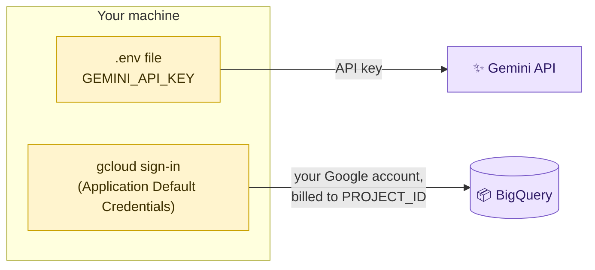

[← Back to README](../../README.md) · **1. Installation** · [2. Using DataChat →](02-using-datachat.md)

# 🛠️ Installation

This guide takes you from an empty machine to a working `You>` prompt. It takes about
**15–20 minutes** the first time, mostly spent creating Google credentials.

## Choose an installation path

| | 🐳 **Option A — Docker** (recommended) | 🐍 **Option B — Local Python** |
|---|---|---|
| **Best for** | Using DataChat | Using DataChat and changing its code |
| **Report database** | Started for you in a container | You install and run PostgreSQL 16+ |
| **Python** | Not needed for the app (only `uv` for one helper script) | Python 3.13, installed by `uv` |
| **Your data is kept in** | Docker volume `pgdata` | Your PostgreSQL server |
| **Typical start command** | `docker compose run --rm datachat --chat --user user-a` | `uv run python main.py --chat --user user-a` |

Both options use the same Google credentials, so do **[Step 0](#step-0--prerequisites-for-both-options)** first.

> [!NOTE]
> Commands are for **Linux and macOS**. On Windows, use **WSL 2** (Ubuntu) and follow the Linux
> instructions inside it.

---

## Step 0 — Prerequisites for both options

### 0.1 Install the tools

| Tool | Why DataChat needs it | Install | Check |
|---|---|---|---|
| **Git** | Download the project | [git-scm.com](https://git-scm.com/downloads) | `git --version` |
| **uv** | Run Python helper scripts | `curl -LsSf https://astral.sh/uv/install.sh \| sh` | `uv --version` |
| **gcloud CLI** | Sign in so BigQuery can be queried | [cloud.google.com/sdk/docs/install](https://cloud.google.com/sdk/docs/install) | `gcloud --version` |
| **Docker + Compose** *(Option A only)* | Run DataChat and its database | [docs.docker.com/get-docker](https://docs.docker.com/get-docker/) | `docker compose version` |
| **PostgreSQL 16+** *(Option B only)* | Store your reports | [postgresql.org/download](https://www.postgresql.org/download/) | `psql --version` |

### 0.2 Get your Google credentials

DataChat uses **two separate** Google credentials:



*Reading the diagram:* the **Gemini API key** is a text key that you put in `.env`. **BigQuery** does
not use a key file. It uses your Google sign-in (`gcloud auth application-default login`), and charges
query costs to the Google Cloud project you name in `PROJECT_ID`.

1. **Gemini API key.** Create one at [aistudio.google.com/apikey](https://aistudio.google.com/apikey)
   and copy it.
2. **Google Cloud project.** In the [Cloud Console](https://console.cloud.google.com/), choose or create
   a project and note its **Project ID** (for example `my-retail-sandbox-123`). Then:
   - enable the **BigQuery API** for that project,
   - make sure your account has the **BigQuery Job User** role on it (project *Owner* or *Editor* already includes it).

   The retail data is Google's public `thelook_ecommerce` dataset, and DataChat only reads it. A
   [BigQuery sandbox](https://cloud.google.com/bigquery/docs/sandbox) project is enough for occasional use.
3. **Sign in for BigQuery:**

   ```bash
   gcloud auth application-default login
   ```

   A browser window opens. Sign in with the Google account that has access to the project.

> [!CAUTION]
> Your `.env` file and the `secrets/` folder contain credentials. Both are already in `.gitignore`.
> **Never commit them, email them or paste them into a chat.**

---

## Option A — Docker

> [!TIP]
> **You don't need to build anything.** A ready-to-use public image is published on Docker Hub as
> [**`delaray/datachat:1.0.0`**](https://hub.docker.com/r/delaray/datachat). It contains the
> application and its locked dependencies, but **no credentials**. Your keys are supplied when the
> container starts (step A.3). It is about 815 MB to download and runs as an unprivileged user.

### A.1 Get the project

```bash
git clone https://github.com/delaray/opsfleet.git datachat
cd datachat
```

You need the repository even with Docker: it contains `compose.yaml` and the database setup scripts.

### A.2 Create your `.env`

```bash
cp .env.example .env
nano .env        # or any text editor
```

Fill in these values. You can leave everything else as it is.

| Variable | Set it to | Example |
|---|---|---|
| `PROJECT_ID` | Your Google Cloud project ID | `my-retail-sandbox-123` |
| `PROJECT_NAME` | A readable name for that project | `my-retail-sandbox` |
| `GEMINI_API_KEY` | The key from step 0.2 | `AIza…` |
| `DATACHAT_DB_PASSWORD` | **Remove the leading `#`**, then choose a strong password | output of `openssl rand -hex 24` |
| `DATACHAT_DB_ADMIN_PASSWORD` | **Remove the leading `#`**, then choose another strong password | output of `openssl rand -hex 24` |

> [!NOTE]
> With Docker, you choose the database passwords yourself. The database container is created with
> them the first time it starts. (Option B generates `DATACHAT_DB_PASSWORD` for you instead.)

### A.3 Turn your credentials into Docker secrets

```bash
uv run --no-project --with python-dotenv python -m scripts.make_docker_secrets
```

Expected output:

```text
Wrote admindb_password, app.env, datachat_db_password, gcp_adc.json, gemini_api_key to /…/datachat/secrets
```

This creates a private `./secrets/` folder (readable only by you). Docker mounts these files into the
containers at runtime, so **your credentials are never stored in the image**. Run this command again
whenever you change a key or sign in again with gcloud.

### A.4 Download the image and start the database

```bash
docker compose pull              # downloads delaray/datachat:1.0.0 from Docker Hub, and postgres:18
docker compose up -d postgres    # starts the report database in the background
docker compose ps                # postgres should show "healthy" after a few seconds
```

`docker compose pull` fetches the pre-built public image
[`delaray/datachat:1.0.0`](https://hub.docker.com/r/delaray/datachat) from Docker Hub, so nothing is
compiled on your machine. You can also download it directly with
`docker pull delaray/datachat:1.0.0`. To build the same image from source instead, run
`docker compose build`.

### A.5 Start DataChat

```bash
docker compose run --rm datachat --chat --user user-a
```

You should see:

```text
OpsFleet analysis session. Type /help for examples or /quit to exit.
Conversation ID: 5f0c…. Use --conversation-id with this ID to resume pending report approvals after restart.
You>
```

🎉 **You're ready.** Continue with [Using DataChat](02-using-datachat.md).

### Docker housekeeping

| I want to… | Command |
|---|---|
| Chat as another executive | `docker compose run --rm datachat --chat --user user-b` |
| Ask one question without chatting | `docker compose run --rm datachat --user user-c --question "Show item counts by category"` |
| Use a different Gemini model | Add `--model MODEL_ID`, or edit `GEMINI_MODEL_1` in `secrets/app.env` |
| Update to the latest image | `docker compose pull` |
| Build the image from source | `docker compose build` |
| Stop everything **and keep my reports** | `docker compose down` |
| ⚠️ Stop everything **and erase all reports, audit history and traces** | `docker compose down -v` |

---

## Option B — Local Python installation

### B.1 Get the project and its dependencies

```bash
git clone https://github.com/delaray/opsfleet.git datachat
cd datachat
uv sync          # installs Python 3.13 (if needed) and the exact locked dependencies into .venv
```

### B.2 Create your `.env`

```bash
cp .env.example .env
nano .env
```

| Variable | Set it to |
|---|---|
| `PROJECT_ID`, `PROJECT_NAME` | Your Google Cloud project (step 0.2) |
| `GEMINI_API_KEY` | Your Gemini API key (step 0.2) |
| `PG_HOST`, `PG_PORT` | Where your PostgreSQL server runs (usually `localhost`, `5432`) |
| `PG_USER`, `PG_PWD` | A PostgreSQL **superuser**, used **only once** by the setup script in the next step |

Leave the `DATACHAT_DB_*` block commented out. The next step fills it in.

### B.3 Create the report database

```bash
uv run python -m scripts.setup_datachatdb
```

This one-time, re-runnable script creates the `datachatdb` database (plus a `datachatdb_test` copy for
tests), its security roles and its tables. It also **adds a newly generated application password to
`.env`**. From then on, DataChat connects with that restricted account, never with your superuser.

### B.4 Install the executives' access rules

```bash
cp config/grants.executives.json config/grants.local.json
```

DataChat reads `config/grants.local.json` by default and refuses to start if that file is missing. It
never falls back to example permissions without telling you. (Alternatively, pass
`--grants config/grants.executives.json` on every run.)

### B.5 Check that everything works

```bash
uv run python main.py --user user-a
```

With no question, DataChat asks *"How many order items can I access?"*. You should get a one-row
table of order items, followed by explanatory notes. Then start a chat:

```bash
uv run python main.py --user user-a --chat
```

🎉 **You're ready.** Continue with [Using DataChat](02-using-datachat.md).

<details>
<summary><b>Optional: run the offline test suite</b></summary>

The tests use made-up data and make **no** Google calls. They do need the `datachatdb_test` database
from step B.3:

```bash
uv run python -m unittest discover -s tests -v
uv run python -m examples.report_demo      # report + deletion walkthrough on a scratch database
```

</details>

---

## Installation checklist

- [ ] `git`, `uv`, `gcloud` installed, plus `docker` **or** PostgreSQL 16+
- [ ] Gemini API key in `.env`
- [ ] `PROJECT_ID` in `.env`, BigQuery API enabled, `gcloud auth application-default login` done
- [ ] **Docker:** `secrets/` created, `postgres` healthy · **Local:** `setup_datachatdb` run, `grants.local.json` copied
- [ ] `You>` prompt appears

Something didn't work? See [Troubleshooting](05-troubleshooting.md#installation-problems).

---

[← Back to README](../../README.md) · **1. Installation** · [2. Using DataChat →](02-using-datachat.md)
