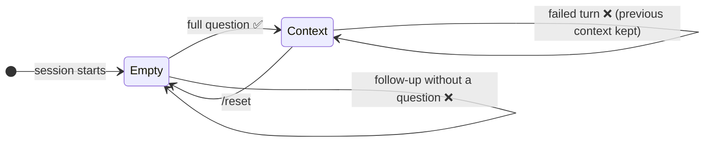
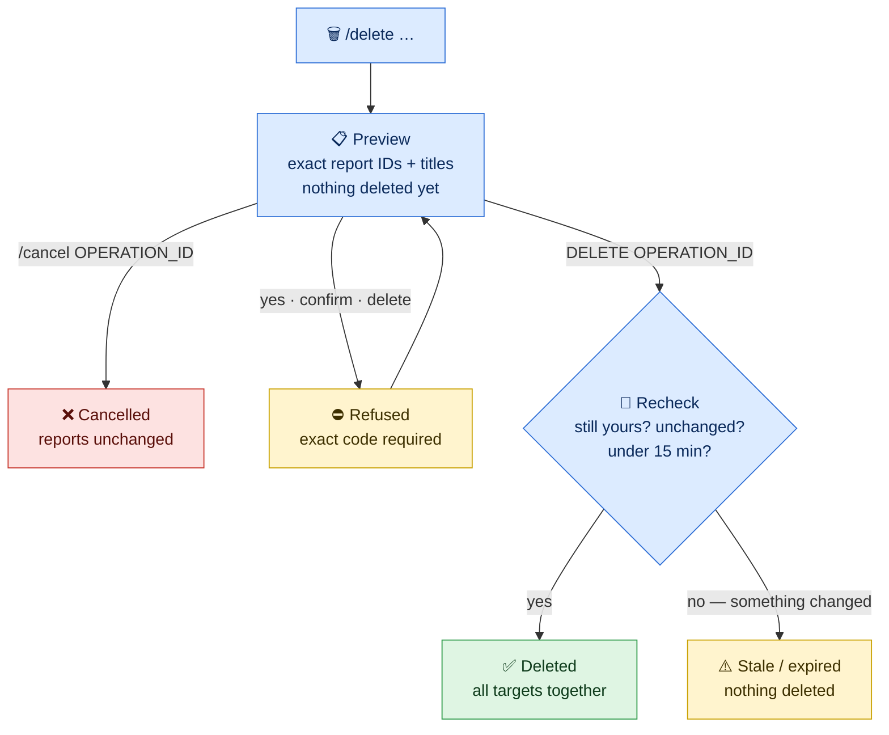

[← 1. Installation](01-installation.md) · **2. Using DataChat** · [3. Roles & Security →](03-roles-and-security.md)

# 💬 Using DataChat

- [Starting a session](#starting-a-session)
- [Task 1 — Analyze data](#task-1--analyze-data)
- [Task 2 — Create and read reports](#task-2--create-and-read-reports)
- [Task 3 — Delete reports](#task-3--delete-reports)
- [Cheat sheet](#cheat-sheet)

> [!NOTE]
> Examples use the **Docker** command prefix. With a local install, replace
> `docker compose run --rm datachat` with `uv run python main.py`. All other options are the same.

---

## Starting a session

```bash
docker compose run --rm datachat --chat --user user-b
```

| Option | Meaning |
|---|---|
| `--user user-a\|user-b\|user-c` | **Required.** The executive identity you work as (see [Roles](03-roles-and-security.md#the-three-executive-roles)). |
| `--chat` | Start an interactive conversation. |
| `--question "…"` | Ask a single question and exit, instead of chatting. |
| `--report` | With `--question`: also save the answer as a report. |
| `--conversation-id UUID` | Reopen an earlier conversation, to finish a pending deletion. |
| `--model MODEL_ID` | Use another Gemini model (default: `GEMINI_MODEL_1`, normally `gemini-3.6-flash`). |
| `--golden-demo` | Show clearly labeled synthetic reference examples to Gemini (demonstration only). |

Run `docker compose run --rm datachat --help` to list the advanced budget options. They are described in
[Troubleshooting § Limits](05-troubleshooting.md#limits-and-budgets).

Every chat starts with a **Conversation ID**. Write it down if you start a deletion that you may need to
finish after restarting. Three commands work at any time:

| Command | Effect |
|---|---|
| `/help` | Show every supported question, follow-up and report command |
| `/reset` | Forget the current analysis context (saved reports are **not** affected) |
| `/quit` or `/exit` (or <kbd>Ctrl</kbd>+<kbd>D</kbd>) | End the session |

---

## Task 1 — Analyze data

### 1.1 Start with a full question

A full question combines **one measure** with an **optional breakdown**. You can type any cell of this
table (capitalization and a trailing `?` or `.` don't matter):

| Measure ↓ · Breakdown → | *(none)* | `by category` | `by month` | `by status` |
|---|---|---|---|---|
| **Item count** | `Show item counts` | `Show item counts by category` | `Show item counts by month` | `Show item counts by status` |
| **Total item sale value** | `Show total item sale value` | `… by category` | `… by month` | `… by status` |
| **Average item sale price** | `Show average item sale price` | `… by category` | `… by month` | `… by status` |

`How many order items can I access?` and `Count order items` are also accepted as item-count questions.

*Reading the table:* rows are what is measured, and columns are how the result is split. For example,
the cell *Total item sale value × by month* is the question `Show total item sale value by month`.

### 1.2 Refine with follow-ups

After a successful answer, you can change one part of the question at a time. DataChat keeps the rest.

| To change the… | Type | Example effect |
|---|---|---|
| **Breakdown** | `by category` · `by month` · `by status` · `overall` | Split differently, or remove the split |
| **Status filter** | `completed items only` (or `same for completed items`) · `all statuses` | Keep only items with status *Complete*, or include all statuses again |
| **Period** | `from 2025-01-01 to 2026-01-01` · `all dates` | Limit to a range of UTC months, or remove the limit |
| **Measure** | `item counts instead` · `total item sale value instead` · `average item sale price instead` | Keep the filters, change what is measured |

> [!TIP]
> **Dates are month boundaries.** Both dates must be the 1st of a month (`YYYY-MM-01`), and the **end
> month is excluded**: `from 2025-01-01 to 2026-01-01` covers all of 2025.



*Reading the diagram:* DataChat remembers **only the last successful question**. A follow-up modifies
it. A new full question replaces it. A **failed** turn (an error, a timeout or an unsupported phrase)
leaves it unchanged, so your next follow-up applies to the last answer that worked. `/reset` clears
everything.

### 1.3 Read the answer

```text
You> Show item counts by category
Product category | Order items
--- | ---
Active | 5324
Jeans | 7851
…
All item statuses included. All available UTC months. Counts measure order items, not distinct orders
or customers. Groups with fewer than 5 distinct customers are suppressed; omitted groups are not zero.
```

Each answer has two parts:

1. **The table.** It contains exactly the values BigQuery returned. DataChat rejects any answer from
   Gemini that changes, rounds or adds values.
2. **The notes.** They state which filters and period were used, and how to read the numbers:

| Note | What it means for you |
|---|---|
| *Counts measure order items* | One order with three items counts as **3**. It is not a count of orders or customers. |
| *Item sale values are not an approved net-revenue measure* | Sale value includes cancelled and returned items unless you add `completed items only`. Don't present it as revenue. |
| *Groups with fewer than 5 distinct customers are suppressed* | Small groups are **hidden** to protect customer privacy. A missing row does **not** mean zero. |
| *No publishable aggregate was returned* | Nothing in your scope matched, or every group was too small to show. |

### 1.4 One-shot questions

To ask a single question without opening a chat:

```bash
docker compose run --rm datachat --user user-b --question "Show total item sale value by status"
```

---

## Task 2 — Create and read reports

A report collects your **recent successful analyses from the current session** (up to 8) into one
structured, saved document.

### 2.1 Create a report

After at least one successful analysis, type any of:

```text
/report
create a report
create a report with action items
save report
```

DataChat saves the report right away and prints its ID and contents:

```text
Saved report 0871fa99-3c1e-4b6a-9f0e-6a2d1c7e5b40

# Retail analysis report
…
```

Every report has the same structure:

| Section | Contents |
|---|---|
| **Scope** | States that the report covers your authorized products at the time it was created |
| **1, 2, … one section per analysis** | The table and notes, **Findings** (for example the highest visible group, ties included) and one **Action item** |
| **Interpretation limits** | What the numbers do *not* prove: causes, trends across partial months, currency or net revenue |

> [!NOTE]
> Report text is written by **trusted code from validated numbers**, not by Gemini. Creating a report
> makes no model call, so it costs nothing and works even if Gemini is unavailable. Action items are
> framed as **steps to investigate**, not as conclusions.

To analyze **and** save in one command:

```bash
docker compose run --rm datachat --user user-c --question "Show item counts by category" --report
```

### 2.2 List and read your reports

| Command | Result |
|---|---|
| `/reports` (or `list my reports`, `list reports`) | One line per report: `REPORT_ID \| title` |
| `/show REPORT_ID` | The full report text |

You can see **only your own reports**. If an administrator has since changed your product access, older
reports are listed with *"contents unavailable under current grants"*. You can still delete them, but
you can't read them until your original access is restored.

> [!IMPORTANT]
> Saved reports are **permanent** (until you delete them). The **analysis context is not**: after
> `/quit`, `/reset` or a restart, run your analyses again before creating a new report.

---

## Task 3 — Delete reports

Deleting always takes **two steps**: DataChat first shows **exactly** what would be deleted, then waits
for you to type a confirmation code that matches that list.

### 3.1 Choose what to delete

| Command | Selects |
|---|---|
| `/delete REPORT_ID` | One report |
| `/delete conversation` (or `Delete all the reports we made in this conversation`) | All reports created in the current conversation |
| `/delete mentioning TEXT` (or `Delete all reports mentioning TEXT`) | Reports whose text contains `TEXT` (exact phrase, any capitalization) |
| `/delete all` (or `delete all my reports`) | All your reports |

DataChat replies with a **preview**, and nothing has been deleted yet:

```text
Pending deletion of 1 report(s); no deletion has occurred.
- 0871fa99-3c1e-4b6a-9f0e-6a2d1c7e5b40 (version 1): Retail analysis — 2 section(s)
Type DELETE 0ec46bd1-7a52-4d0f-8d1c-2b9e6f3a1c77 to confirm these exact targets,
or /cancel 0ec46bd1-7a52-4d0f-8d1c-2b9e6f3a1c77. Confirmation expires 15 minutes after the original request; resuming does not extend it.
```

### 3.2 Confirm or cancel

| To… | Type |
|---|---|
| ✅ **Confirm** | `DELETE OPERATION_ID`: the word `DELETE` in capitals, then the exact ID from the preview |
| ❌ **Cancel** | `/cancel OPERATION_ID` |



*Reading the diagram:* blue boxes are steps where you are still deciding, green means the reports
were deleted, yellow means DataChat refused or stopped without deleting anything, and red means you
cancelled. The confirmation applies to the **frozen list shown in the preview**: a report created
after the preview is never included. If any listed report changed in the meantime, **none** of them
are deleted.

> [!WARNING]
> - Typing `yes`, `confirm` or `delete` does **not** confirm. Only `DELETE` followed by the matching
>   operation ID does.
> - A confirmation **expires after 15 minutes**. After that, start a new `/delete`.
> - One deletion can include at most **100 reports**. If your selection matches more, DataChat asks
>   you to narrow it. It never deletes only some of them.
> - Deleted reports disappear from all your lists. DataChat performs a *soft* deletion, so the
>   administrator still holds the record (see [Governance](03-roles-and-security.md#governance-and-audit)).

### 3.3 Finish a deletion after a restart

Pending deletions are saved in the database and survive a restart. To finish one, reopen the
**original** conversation:

```bash
docker compose run --rm datachat --chat --user user-a --conversation-id ORIGINAL_CONVERSATION_ID
```

```text
You> /pending                      ← list pending deletions in this conversation
You> /resume OPERATION_ID          ← show that exact preview again
You> DELETE OPERATION_ID           ← or /cancel OPERATION_ID
```

### 3.4 Check your history

`/audit` lists every action on your reports, oldest first:

```text
report_saved | - | ["0871fa99-…"]
deletion_requested | 0ec46bd1-… | ["0871fa99-…"]
deletion_cancelled | 0ec46bd1-… | ["0871fa99-…"]
```

---

## Cheat sheet

<table>
<tr><th>🔍 Analyze</th><th>📝 Reports</th><th>🗑️ Delete</th></tr>
<tr valign="top"><td>

```text
Show item counts by category
Show total item sale value by month
Show average item sale price by status

by month | by category | by status
overall
completed items only | all statuses
from 2025-01-01 to 2026-01-01
all dates
total item sale value instead
average item sale price instead
item counts instead
```

</td><td>

```text
/report
/reports
/show REPORT_ID
```

</td><td>

```text
/delete REPORT_ID
/delete conversation
/delete mentioning TEXT
/delete all
DELETE OPERATION_ID
/cancel OPERATION_ID
/pending
/resume OPERATION_ID
/audit
```

</td></tr>
<tr><td colspan="3">⚙️ <code>/help</code> · <code>/reset</code> · <code>/quit</code></td></tr>
</table>

---

[← 1. Installation](01-installation.md) · **2. Using DataChat** · [3. Roles & Security →](03-roles-and-security.md)
